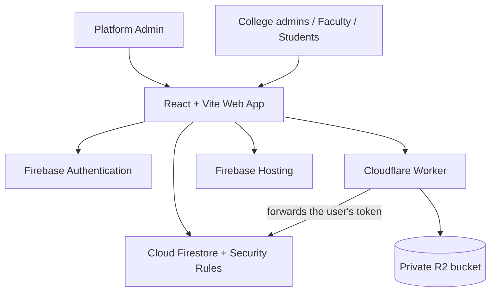

# College Management System — System Design (MVP)

**Version:** 1.3  
**Status:** Proposed architecture  
**Last updated:** 2026-10-31  
**Companion:** `product.md`

## 1. Scope and architectural approach

Build a client-rendered React application as a **multi-tenant SaaS**: many colleges (tenants) share one Firebase project, one Auth user pool and one deployment. Each college sees only its own data. There is no separate API server.

The project starts on the **Firebase Spark (free) plan**. Spark constraints that shape this design:

- **No Cloud Functions** (they need Blaze). Server-side trust is enforced by **Firestore Security Rules** plus client batches (and, for files only, a small Cloudflare Worker). There is no privileged backend code.
- **Hard daily quotas shared by all colleges.** Firestore free quota: 50k reads, 20k writes, 20k deletes per day, 1 GiB stored. When a quota is used up, the service stops for every college until reset. Rules cannot limit one college's usage. Check current numbers before launch.
- **No managed backups or scheduled exports.** Backup is a local script (section 9).
- **No Firebase Storage** (a new project may need Blaze for it). Student files go to a private **Cloudflare R2** bucket behind a **Cloudflare Worker**, both on free plans. See section 5.3.

**Spark is a pilot plan for one college of about 2000 students, or two small ones.** On a normal day that college uses about half of the daily writes, and on a marks-entry day it can use more than all of them (section 8). Onboarding more paying colleges needs the Blaze plan, which also unlocks Cloud Functions (section 12).

Rules cannot do everything. They cannot run loops, cannot filter list queries by a lookup, and allow only a few document lookups (`get`/`exists`) per request. Every design choice below stays inside those limits.

**Frontend:** React + Vite + JavaScript, React Router, and a data-access layer of feature services around Firebase SDK calls.

**Architecture style:** modular frontend (`students`, `faculty`, `academics`, `attendance`, `exams`, `announcements`, `platform`).

## 2. High-level architecture



| Service | Responsibility |
|---|---|
| Firebase Authentication | Email/password sign-in and password reset for all colleges |
| Cloud Firestore | All application data and audit events, separated per college by path |
| Cloudflare R2 + Worker | Student documents and profile photos in a private bucket. The Worker is the only way in or out, and it lets Firestore Security Rules decide who may access a file |
| Firebase Hosting | React production build and SPA routes |
| Firebase Emulator Suite | Local development and automated Auth/Firestore rule tests (the Worker is tested with `wrangler dev`) |
| App Check (reCAPTCHA) | Reject calls that do not come from the real web app; start in monitor mode |

Use a separate Firebase project for development and production. Never commit service-account keys. The backup script's key stays on the Platform Admin's machine only.

## 3. Frontend structure

```text
src/
  app/            App.jsx, router.jsx, providers/
  components/     layout/, common/, forms/, tables/
  features/       auth/ platform/ dashboard/ students/ faculty/ academics/ attendance/ exams/ announcements/ users/
  hooks/
  lib/            firebase.js, auth.js, firestore.js, files.js, permissions.js
  services/       studentService.js, facultyService.js, academicService.js, attendanceService.js, examService.js
  utils/
  styles/
```

Guidelines:
- Keep Firestore queries and writes in feature services, not in components.
- Build every tenant path in one helper (`tenantPath(institutionId, ...)`) from the signed-in user's profile, so no screen can build another college's path by accident.
- Use React Context for the signed-in user (including its `users/{uid}` profile).
- Route guards are for user experience only. Security Rules are the enforcement.
- Validate in the UI and repeat all important validation in Security Rules.
- Paginate lists. Use one-time reads, not live listeners, except for small actively viewed data.

## 4. Firestore data model

### 4.0 Tenancy model

- **All college data lives under `institutions/{institutionId}/…`.** Every collection below, except `users` and `platformAuditLogs`, is a subcollection of the college's own document, for example `institutions/{institutionId}/students/{studentId}`. Rules read the college from the **path**, never from a field inside the document, so a document cannot claim to belong to another college.
- **No ID collisions between colleges.** Deterministic IDs (enrollment keys, timetable locks) are unique inside one college's path only. Two colleges can use the same enrollment number or room name.
- **`users/{uid}` is the only global lookup.** It holds the user's `institutionId`, which rules compare to the path. Only admins can write it, and `institutionId` can never change.
- **One email belongs to one college.** The Auth user pool is shared. `shortcut:` a person at two colleges needs two email addresses. Upgrade: Identity Platform multi-tenancy on Blaze.
- **Platform Admin** is the SaaS owner. The role is created by hand in the console. A Platform Admin can create and suspend colleges and manage each college's first Super Admin. Rules give a Platform Admin **no access** to any college's students, attendance, marks or audit logs, and a Platform Admin cannot create a Super Admin for an existing college. The Firebase project owner can still read everything in the console.
- **Suspension:** `institutions/{id}.status` is `ACTIVE` or `SUSPENDED`. Rules check it on every tenant request, so suspending a college locks out all its users on their next request. This costs one extra lookup per request.
- **Not in the MVP:** self-service college sign-up, subscription billing and payments (the Platform Admin creates and suspends colleges by hand), custom domains or branding.

**Dates:** store calendar dates (`date`, `admissionDate`) as `YYYY-MM-DD` strings in the college's time zone, never as UTC timestamps. Use server timestamps only for event times such as `createdAt`. `shortcut:` the client supplies the date string and rules only check its shape; a faculty member could back-date a register, and the audit log shows who. Upgrade to a server-computed date on Blaze.

**`updatedAt`:** every document carries a server `updatedAt` timestamp, set on every write. The backup script uses it to export only what changed.

### 4.1 Identity and institution

| Collection | Important fields |
|---|---|
| `institutions/{institutionId}` | name, code, address, contact, timezone, academicSettings, status (`ACTIVE`, `SUSPENDED`), plan (a free-text note set by the Platform Admin), createdAt, updatedAt, auditId |
| `users/{uid}` | institutionId, role (`PLATFORM_ADMIN`, `SUPER_ADMIN`, `COLLEGE_ADMIN`, `FACULTY`, `STUDENT`), displayName, email, studentId or facultyId, active, createdAt, updatedAt, auditId |
| `platformAuditLogs/{logId}` | actorUid, action, institutionId, timestamp, metadata |

The `users/{uid}` document is the **single source of role and status**. There are no custom claims, because setting claims needs the Admin SDK on a server. Rules read this document with one `get()`.

- **Who can create whom:** the Platform Admin creates the college and its first `SUPER_ADMIN`, and only in the same batch that creates the college. Afterwards the Platform Admin can only deactivate or reactivate a Super Admin; replacing a lost Super Admin is done in the Firebase console. A college's Super Admin creates `COLLEGE_ADMIN`, `FACULTY` and `STUDENT` users in the same college. A College Admin creates `FACULTY` and `STUDENT` users only. Nobody can create or assign `PLATFORM_ADMIN` from the client, and nobody edits their own account. The first Platform Admin is created by hand in the Firebase console.
- Every user write and every college create/suspend needs a new audit entry in the same batch (college audit for college users, `platformAuditLogs` for platform actions).
- Setting `active = false` takes effect on the next request, because rules check `active` on every access. Deactivating a student or faculty member is one batch: the profile `status`, `users.active = false` and a new audit entry. Changing only the profile `status` would leave the login working.
- A signed-in user may read only their own `users` document. College admins may read the users of their own college. A Platform Admin may read users to manage Super Admins.

**Account creation (no Admin SDK):** an admin creates the Auth account from the browser using a **secondary Firebase app instance**, so the admin stays signed in. The password is a random 32-character string that is never shown or stored, so the admin never knows it. They then write the `users` document and a new audit entry in one batch and send a password-reset email, which is how the person sets their own password. Keep the new `uid` in memory and retry only the Firestore write if it fails. If the tab closes first, the Auth account is orphaned and its email stays "in use": delete it in the Firebase console, then create the user again. `shortcut:` the Auth account cannot be disabled from the client; deactivation is enforced by `active` in rules only. Upgrade to Admin SDK in a function on Blaze. `shortcut:` one email belongs to one college, so a hostile admin can create accounts for another college's emails, and those people then cannot be added there ("email already in use"). Procedure: on that college's request the Platform Admin deletes the Auth user in the Firebase console, which frees the email. Upgrade: Identity Platform multi-tenancy or server-side creation on Blaze.

### 4.2 Academic structure and profiles

All collections in this and the following sections are under `institutions/{institutionId}/`.

| Collection | Important fields |
|---|---|
| `departments/{departmentId}` | name, code, status |
| `courses/{courseId}` | departmentId, name, code, duration, status |
| `subjects/{subjectId}` | courseId, name, code, semesterNumber, maxMarks, passMarks |
| `academicYears/{yearId}` | label, startDate, endDate, active |
| `semesters/{semesterId}` | courseId, academicYearId, number, startDate, endDate |
| `sections/{sectionId}` | courseId, semesterId, academicYearId, name, room |
| `students/{studentId}` | uid, enrollmentNumber, enrollmentKey, name, email, phone, admissionDate, departmentId, courseId, status |
| `students/{studentId}/documents/{docId}` | name, kind (`DOCUMENT` or `PROFILE_PHOTO`), objectKey, contentType, size, status (`PENDING`, `READY`, `DELETED`), uploadedBy, createdAt, updatedAt |
| `faculty/{facultyId}/documents/{docId}` | same fields as student documents (kind `DOCUMENT`) |
| `teachingAssignments/{assignmentId}/documents/{docId}` | same fields (kind `MATERIAL`; `name` is the title shown to students) |
| `faculty/{facultyId}` | uid, employeeCode, name, email, phone, departmentId, designation, status |
| `enrollments/{studentId}_{semesterId}` | studentId, studentName, enrollmentNumber, courseId, academicYearId, semesterId, sectionId, status (`ACTIVE`, `COMPLETED`, `WITHDRAWN`), enrolledAt |
| `teachingAssignments/{assignmentId}` | facultyId, subjectId, sectionId, academicYearId, semesterId, active |
| `timetableSlots/{slotId}` | sectionId, subjectId, facultyId, dayOfWeek, period, room, roomKey |
| `timetableLocks/{type}_{id}_{day}_{period}` | slotId (type is `room`, `faculty` or `section`) |
| `enrollmentNumberIndex/{enrollmentKey}` | studentId |

- **One place for current class:** `students` holds only stable profile data. The student's course, semester and section live in `enrollments`, one document per period, so history is never overwritten. `enrollments` copies `studentName` and `enrollmentNumber` for display, so faculty rosters never need to read `students`.
- **Unique enrollment numbers (per college):** `enrollmentKey` is the number upper-cased and trimmed, and rules enforce that. The client creates the `students` document and `enrollmentNumberIndex/{enrollmentKey}` in one batch. The index rule allows `create` only, so `cs-001` and `CS-001` collide and the batch fails. The `students` rule requires the index document in the same batch (`existsAfter`). `enrollmentNumber` cannot be changed after creation, and students cannot be deleted (set `status` instead, STU-05).
- **Timetable conflicts (ACA-05):** `roomKey` is the room name lower-cased and trimmed, with no `/` (rules enforce it), so "Room 101" and "room 101" collide. A slot is saved in one batch with three lock documents: `room_{roomKey}_{day}_{period}`, `faculty_{facultyId}_{day}_{period}` and `section_{sectionId}_{day}_{period}`. Locks are `create`-only. **The slot rule requires each of the three locks to exist after the batch and to name this slot** (`getAfter(lock).data.slotId == slotId`). Creating a clashing slot fails because the lock already exists. Moving a slot onto another slot's place fails because that lock names the other slot. This holds for concurrent saves too. Moving or deleting a slot deletes its old locks in the same batch. `shortcut:` rules do not check that a deleted lock belonged to a deleted slot; only admins can write locks.
- **Read access limits:** rules cannot filter a list query by a lookup, so faculty may read `enrollments` of their own college (names, numbers, sections only), and every active user of the college may read reference data (departments, courses, subjects, sections, timetable, exams, announcements) and `teachingAssignments` (no personal data), so a student can list their class's subjects. `students` (phone, email) is admin-only, plus the student's own record.

### 4.3 Attendance

| Collection | Important fields |
|---|---|
| `studentAttendance/{studentId}_{assignmentId}` | studentId, subjectId, semesterId, sectionId, assignmentId, facultyId, records, updatedBy, updatedAt, auditId (only on edits) |
| `classSessions/{assignmentId}_{date}_{period}` | assignmentId, sectionId, subjectId, facultyId, date, period, presentCount, absentCount, leaveCount, updatedAt |
| `facultyAttendance/{facultyId}_{date}` | facultyId, date, status, markedBy, updatedAt |

`records` is a map from `d{YYYYMMDD}_{period}` to a status string (`PRESENT`, `ABSENT`, `LEAVE`), for example `{"d20261031_2": "PRESENT"}`. Keys start with a letter and have no `-`, so they are valid Firestore field paths. One document per student per teaching assignment (about one per subject per semester) holds the whole semester (about 200 entries, a few KB). One document per student per *session* would add about 10 MB a day per college, fill the free 1 GiB in 3 to 4 months, and make a full backup pass the daily read quota.

- **No duplicates:** the document ID and the map key are both deterministic, so one student cannot have two records for the same session.
- **Faculty create rule:** the role is `FACULTY`, `facultyId` equals the signed-in faculty's, and the assignment named by `assignmentId` (one `get()`) belongs to that faculty, is `active`, and has the same `sectionId`, `subjectId` and `semesterId` as the document. A faculty member cannot label records with a class they do not teach.
- **Faculty update rule:** the assignment in `assignmentId` must still belong to the signed-in faculty and be `active` (`assignment.facultyId == me().facultyId`), so a replaced teacher loses write access at once. Only `records`, `updatedBy`, `updatedAt` and `auditId` may change. Exactly one map entry changes per write, and none is removed. Adding a new entry is free. Changing an existing entry requires an audit entry that is **new in the same batch** (section 4.5).
- **Class summary:** in the same batch the faculty writes `classSessions` with present/absent/leave counts. The admin dashboard "today" summary adds up the `classSessions` for `date == today` (about 100 documents per college). `shortcut:` the counts are reported by the client, and edits must update them in the same batch. They can drift from `records` if a client is buggy. Recompute them from `records` in a function on Blaze.
- `shortcut:` rules do not check that each student is enrolled in the section; that needs one lookup per student and breaks the per-request lookup limit. Reports read the roster from `enrollments`, so a stray record counts for no one. Upgrade to a Cloud Function on Blaze.
- **Percentage:** read the student's `studentAttendance` documents for the semester (one per assignment), add up those with the same `subjectId`, and compute present / (present + absent) × 100 in the client. `LEAVE` is excluded.
- **Reads:** a student reads documents with their own `studentId`. A faculty member reads documents with their own `facultyId`. Admins of the college read all.
- **Changing teacher:** never edit `teachingAssignments.facultyId`. Create a new assignment for the new or substitute teacher and set the old one `active = false`. The new teacher gets their own documents, and the old teacher can no longer write.

### 4.4 Examinations and results

| Collection | Important fields |
|---|---|
| `exams/{examId}` | name, type, academicYearId, courseId, semesterId, startDate, endDate, status (`DRAFT`, `PUBLISHED`) |
| `examSubjects/{examSubjectId}` | examId, subjectId, maxMarks, passMarks |
| `studentMarks/{examSubjectId}_{studentId}` | examId, examSubjectId, assignmentId, sectionId, studentId, marks, absent, enteredBy, updatedAt |
| `results/{examId}_{studentId}` | examId, studentId, total, percentage, passed, computedAt |

- **Marks rules:** the exam is found **through the exam subject** (`examSubject = get(examSubjects/{examSubjectId})`, `exam = get(exams/{examSubject.examId})`), never from a field the client sends, and the document's `examId` must equal `examSubject.examId`. The exam must be `DRAFT`, so marks are locked once results are published. The assignment must belong to the faculty and be `active`; its `subjectId` must equal the exam subject's, its `semesterId` must equal the exam's, and the document's `sectionId` must equal the assignment's. Unless `absent` is true, `0 <= marks <= examSubject.maxMarks`. The ID must be `{examSubjectId}_{studentId}`.
- **Marks are owned by the assignment that created them.** On update, `assignment(resource.data.assignmentId).facultyId` must equal the signed-in faculty, and `assignmentId`, `sectionId`, `examId`, `examSubjectId` and `studentId` cannot change. A teacher of Section A therefore cannot overwrite Section B's marks for the same subject. `shortcut:` rules do not check that the student is enrolled in the section (one lookup per student). So a teacher can still create a record for another section's student first. The publish screen flags any marks whose `sectionId` differs from the student's enrollment section, and an admin fixes them. To correct a mark after publishing, an admin sets the exam back to `DRAFT`, the faculty corrects it, and the admin re-publishes. An admin can delete a stray or wrong marks record while the exam is a draft (the right teacher then re-enters it); this is the only way to clear a record the owning teacher can no longer change, for example after a teacher replacement. Papers (`examSubjects`) can be created or changed only while the exam is a draft. Students have no read access to `studentMarks`.
- **Publishing is one write.** An admin computes `results` in the client (recomputing all of them) and writes them in chunks of at most 500, while the exam is `DRAFT`. Students cannot read results while the exam is `DRAFT`. When all chunks succeed, the admin sets `exams/{examId}.status = PUBLISHED`. The student read rule checks `get(exams/{examId}).data.status == 'PUBLISHED'` and `studentId` equals the student's own. A failed publish shows nothing to students, and re-running is safe because IDs are deterministic. Unpublishing sets the exam back to `DRAFT`.
- **No publishing with gaps:** the publish screen lists every enrolled student and exam subject that has no `studentMarks` document, and refuses to publish until none are missing. A student who did not sit a paper gets a document with `absent: true` and no `marks`; the client counts that paper as 0 and the result shows the absence.
- Pass/fail and percentage are computed in the client from `examSubjects`. `shortcut:` rules do not recompute them, so only admins may write `results`, and only while the exam is `DRAFT`.

### 4.5 Announcements and audit

| Collection | Important fields |
|---|---|
| `announcements/{announcementId}` | title, body, audienceRoles, publishedAt, createdBy, status |
| `auditLogs/{logId}` | actorUid, action, entityType, entityId, timestamp, metadata (old and new values) |

`auditLogs` (under the college) is **create-only**. Only `FACULTY`, `COLLEGE_ADMIN` and `SUPER_ADMIN` of that college may create entries, so students cannot fill the quota with fake logs. The rule requires `actorUid == request.auth.uid` and `timestamp == request.time`. Nobody can update or delete audit records. The entry must be **new**: `!exists` before the batch and `existsAfter` it. A write that points to an old log is rejected, so one entry cannot cover many edits. That rule is required for user changes, deactivation and changes to an existing attendance entry. Marks changes and result publishing are also logged by the client, without rule enforcement. `platformAuditLogs` works the same way for Platform Admin actions. `shortcut:` the old/new values inside an entry are written by the client and are not verified against the real change; only who and when are. Upgrade to function-written logs on Blaze. `shortcut:` rules cannot limit how often an allowed user writes, so a hostile staff member could use up the shared daily write quota with repeated writes (audit entries, or file create/delete cycles that reuse a slot). App Check and watching usage in the Firebase console are the only brakes on Spark. Upgrade: server-side rate limits and server-written logs on Blaze.

## 5. Security architecture

### 5.1 Authentication and role assignment

- Email/password sign-in. Password reset by email. Never store passwords in Firestore or send them in email.
- Admins provision accounts as described in 4.1.
- On every access, rules check that `users/{uid}` exists, `active == true`, the user's `institutionId` equals the path's college, the college is `ACTIVE`, and the role fits. On login, the client loads the profile and signs out inactive users.
- A College Admin cannot create or change a Super Admin or another College Admin; only the college's Super Admin can. Only the Platform Admin touches Super Admin accounts. Super Admin and Platform Admin accounts should use strong unique passwords. Firebase MFA needs Identity Platform (Blaze), so it is not available.

### 5.2 Authorization

- Deny by default. Allow each operation explicitly.
- **Tenant check first:** every rule under `institutions/{institutionId}` starts with "the signed-in user belongs to this institution and it is active". A user of college A gets a denial for any path of college B. Queries must be built from the user's own `institutionId` path.
- Students read only their own profile, enrollments, attendance, published results, and the materials of classes they are enrolled in (and not withdrawn from). Reference data (departments, courses, subjects, sections, timetable, exams, announcements) is readable by every active user of the college, because rules cannot check "belongs to my section" in a list query. `audienceRoles` on announcements only filters the UI.
- Faculty create or update attendance and marks only for their assignments, and read only attendance they wrote.
- College Admin manages college records but cannot grant Super Admin.
- The Platform Admin has no access to college data, only to `institutions` documents, Super Admin `users` documents and `platformAuditLogs`.
- No Admin SDK credentials in the browser. The backup script runs only on a trusted machine.

### 5.3 Files (Cloudflare R2 + Worker)

All files go to a **private R2 bucket**: no public access, and no bucket keys in the browser. A small Cloudflare Worker (free plan, code in `worker/`) is the only way in or out. There are three kinds of file:

| Kind | Firestore metadata path (under the college) | Uploaded by | Opened by | Max size |
|---|---|---|---|---|
| Student documents and photos (STU-03) | `students/{studentId}/documents/{docId}` | college admins | admins, the student | 1 MB |
| Faculty's own documents (FAC-05) | `faculty/{facultyId}/documents/{docId}` | that faculty member, admins | the same people | 1 MB |
| Class materials (MAT-01) | `teachingAssignments/{assignmentId}/documents/{docId}` | admins, and the teacher whose assignment is `active` | admins, that teacher, and students whose enrollment has the assignment's section and semester | 2 MB |

- **Object key:** `{institutionId}/{collection}/{ownerId}/{docId}` with a `docId` that is a fixed slot (`f01`–`f20` for students and faculty, `m001`–`m100` for class materials), where `collection` is `students`, `faculty` or `teachingAssignments`. No personal data in keys or file names. The rules accept no other `docId`, so **the rules themselves cap the number of files** per folder, and a deleted record frees its slot. This caps stored records and R2 objects, not writes (see the shortcut in 4.5). The rules also require `objectKey` to match the metadata path.
- **Firestore decides, not the Worker.** The Worker never holds a permission list. It forwards the caller's own Firebase ID token to the Firestore REST API and reads **one document**: the file's metadata document. Firestore checks the token and applies the Security Rules (right college, `active`, college not suspended, and the kind-specific rule above, including the class-enrollment check for materials). If Firestore refuses, the Worker answers 403. Because Firestore accepted the token for that read, the token is genuine and the Worker can read the `uid` from it. The Worker needs no token-checking code and no secrets.
- **Status:** `PENDING` → `READY` → `DELETED`. The rules let only the people who may upload change it. A reader, such as a student, cannot. Status only moves forward (nothing leaves `DELETED`), and the metadata document can be deleted only when its status is `DELETED`, which means the Worker has already removed the object.
- **Endpoints** (`{collection}` must be one of the three names; the object key always comes from the URL path, never from a document field):
  - `PUT /files/{iid}/{collection}/{ownerId}/{docId}` — upload. The metadata document must be readable by the caller, have `status == PENDING` and `uploadedBy == uid`. Only someone allowed to upload could create it, so the Worker does no role check. The Worker answers 411 if `Content-Length` is missing and 413 if it exceeds the metadata `size` (itself at most the kind's limit). `Content-Type` must equal the metadata `contentType`. Then it streams the body into R2 through the bucket binding. After the write it compares the stored object's real size with the metadata `size`; if they differ it deletes the object and answers 400.
  - `GET /files/...` — download. Requires `status == READY`. Response headers: `Content-Disposition: attachment`, `X-Content-Type-Options: nosniff`, `Cache-Control: private, no-store`.
  - `DELETE /files/...` — requires `status == DELETED`, not just read access. A student who can read a file therefore cannot delete it. The Worker removes the object, then the client deletes the metadata document.
- **Upload order:** create the metadata document first, in the first free slot (rules check slot, path, type and size) → `PUT` to the Worker → set `status = READY`. A failed upload leaves a `PENDING` document that the UI offers to retry or delete. `shortcut:` a client can mark a file `READY` without uploading, which gives a broken link only; a failed delete can leave an orphan object that costs a little storage. A weekly check on Blaze can clean these.
- **Limits:** PDF, JPEG or PNG only; compress images in the browser before upload. `shortcut:` the Worker cannot check that bytes match the declared type; `attachment` and `nosniff` stop the browser from running them. There is no virus scan. The per-folder file cap comes from the fixed slot IDs, not from the Worker.
- **CORS:** the Worker answers only the app's Hosting domain.
- **Showing files:** a plain `` or `<iframe src>` sends no login token, so the app fetches each file with the token and shows it through a blob URL (`URL.createObjectURL`). That is also why the response is `attachment`: files are never opened by a direct link.
- **Free-plan limits (verify before launch):** R2 about 10 GB stored, shared by all colleges; Workers free plan about 100k requests a day. Enabling R2 may ask for a payment method.
- Result and receipt PDFs are not stored: reports are CSV or the browser's print-to-PDF.

### 5.4 Example Firestore rule pattern

Conceptual starting point, not a full ruleset. Review and test every collection and operation before deployment. Audit entry creation must be in the same batch as the write that needs it. The first Platform Admin's `users` document is created by hand in the console.

```javascript
rules_version = '2';
service cloud.firestore {
  match /databases/{database}/documents {
    function me() {
      return get(/databases/$(database)/documents/users/$(request.auth.uid)).data;
    }
    function platform() {
      return request.auth != null && me().active == true && me().role == 'PLATFORM_ADMIN';
    }
    // Signed in, active, belongs to this college, and the college is not suspended.
    function tenantOk(iid) {
      return request.auth != null && me().active == true && me().institutionId == iid
        && get(/databases/$(database)/documents/institutions/$(iid)).data.status == 'ACTIVE';
    }
    function role() { return me().role; }
    function isAdmin(iid) { return tenantOk(iid) && role() in ['SUPER_ADMIN', 'COLLEGE_ADMIN']; }
    function isStaff(iid) { return tenantOk(iid) && role() in ['FACULTY', 'COLLEGE_ADMIN', 'SUPER_ADMIN']; }
    // Roles the caller may create or change. Nobody can grant SUPER_ADMIN or PLATFORM_ADMIN here.
    function manageable(r) {
      return r in ['FACULTY', 'STUDENT'] || (role() == 'SUPER_ADMIN' && r == 'COLLEGE_ADMIN');
    }
    // The audit entry must be created in this batch; an old entry cannot be reused.
    function newAudit(iid, id) {
      return !exists(/databases/$(database)/documents/institutions/$(iid)/auditLogs/$(id))
        && existsAfter(/databases/$(database)/documents/institutions/$(iid)/auditLogs/$(id));
    }
    function newPlatformAudit(id) {
      return !exists(/databases/$(database)/documents/platformAuditLogs/$(id))
        && existsAfter(/databases/$(database)/documents/platformAuditLogs/$(id));
    }

    match /platformAuditLogs/{id} {
      allow create: if platform() && request.resource.data.actorUid == request.auth.uid
        && request.resource.data.timestamp == request.time;
      allow read: if platform();
    }

    match /users/{uid} {
      allow read: if request.auth != null && (request.auth.uid == uid || platform()
        || isAdmin(resource.data.institutionId));
      allow create: if
        (platform() && request.resource.data.role == 'SUPER_ADMIN'
          // only in the batch that creates the college
          && !exists(/databases/$(database)/documents/institutions/$(request.resource.data.institutionId))
          && existsAfter(/databases/$(database)/documents/institutions/$(request.resource.data.institutionId))
          && newPlatformAudit(request.resource.data.auditId))
        || (isAdmin(request.resource.data.institutionId)
          && manageable(request.resource.data.role)
          && newAudit(request.resource.data.institutionId, request.resource.data.auditId));
      allow update: if request.auth.uid != uid
        && request.resource.data.institutionId == resource.data.institutionId
        && (
          (platform() && resource.data.role == 'SUPER_ADMIN' && request.resource.data.role == 'SUPER_ADMIN'
            && newPlatformAudit(request.resource.data.auditId))
          || (isAdmin(resource.data.institutionId)
            && manageable(resource.data.role) && manageable(request.resource.data.role)
            && newAudit(resource.data.institutionId, request.resource.data.auditId)));
    }

    match /institutions/{iid} {
      allow read: if tenantOk(iid) || platform();
      allow create: if platform() && request.resource.data.status == 'ACTIVE'
        && newPlatformAudit(request.resource.data.auditId);
      allow update: if (platform() && newPlatformAudit(request.resource.data.auditId))
        || (tenantOk(iid) && role() == 'SUPER_ADMIN'
          && request.resource.data.diff(resource.data).affectedKeys()
               .hasOnly(['name', 'address', 'contact', 'timezone', 'academicSettings', 'updatedAt']));

      function assignment(id) {
        return get(/databases/$(database)/documents/institutions/$(iid)/teachingAssignments/$(id)).data;
      }

      // File IDs are fixed slots, so rules cap the files per folder: f01-f20 (students, faculty), m001-m100 (class materials).
      function validSlot(collection, docId) {
        return collection == 'teachingAssignments'
          ? docId.matches('m(00[1-9]|0[1-9][0-9]|100)')
          : docId.matches('f(0[1-9]|1[0-9]|20)');
      }
      // Shared checks for file metadata documents (section 5.3).
      function newFile(collection, ownerId, docId, maxSize) {
        return validSlot(collection, docId)
          && request.resource.data.objectKey == iid + '/' + collection + '/' + ownerId + '/' + docId
          && request.resource.data.uploadedBy == request.auth.uid
          && request.resource.data.status == 'PENDING'
          && request.resource.data.size <= maxSize
          && request.resource.data.contentType in ['application/pdf', 'image/jpeg', 'image/png'];
      }
      // Allowed moves: PENDING to READY, READY to DELETED, PENDING to DELETED. Nothing leaves DELETED.
      function fileStatusChange() {
        return ((resource.data.status == 'PENDING' && request.resource.data.status in ['READY', 'DELETED'])
            || (resource.data.status == 'READY' && request.resource.data.status == 'DELETED'))
          && request.resource.data.diff(resource.data).affectedKeys().hasOnly(['status', 'updatedAt']);
      }
      // The metadata document goes only after the Worker removed the object (status DELETED).
      function fileDeletable() { return resource.data.status == 'DELETED'; }

      // Reference data any active user of the college may read: departments, courses, subjects,
      // academicYears, semesters, sections, timetableSlots (see below), teachingAssignments, exams, examSubjects, announcements.
      match /departments/{id} {
        allow read: if tenantOk(iid);
        allow write: if isAdmin(iid);
      }

      match /students/{studentId} {
        allow read: if isAdmin(iid) || (tenantOk(iid) && role() == 'STUDENT' && me().studentId == studentId);
        allow create: if isAdmin(iid)
          && request.resource.data.enrollmentKey == request.resource.data.enrollmentNumber.upper().trim()
          && existsAfter(/databases/$(database)/documents/institutions/$(iid)/enrollmentNumberIndex/$(request.resource.data.enrollmentKey));
        allow update: if isAdmin(iid)
          && request.resource.data.enrollmentNumber == resource.data.enrollmentNumber
          && request.resource.data.enrollmentKey == resource.data.enrollmentKey;
        // No delete: deactivate with status instead (history is kept).

        // File metadata for the R2 Worker (section 5.3). The Worker reads this document with the caller's token.
        match /documents/{docId} {
          allow read: if isAdmin(iid) || (tenantOk(iid) && role() == 'STUDENT' && me().studentId == studentId);
          allow create: if isAdmin(iid) && newFile('students', studentId, docId, 1048576);
          allow update: if isAdmin(iid) && fileStatusChange();
          allow delete: if isAdmin(iid) && fileDeletable();
        }
      }

      match /faculty/{facultyId} {
        // profile rules omitted in this example
        match /documents/{docId} {
          function mine() {
            return isAdmin(iid) || (tenantOk(iid) && role() == 'FACULTY' && me().facultyId == facultyId);
          }
          allow read: if mine();
          allow create: if mine() && newFile('faculty', facultyId, docId, 1048576);
          allow update: if mine() && fileStatusChange();
          allow delete: if mine() && fileDeletable();
        }
      }

      match /teachingAssignments/{assignmentId} {
        allow read: if tenantOk(iid);
        allow write: if isAdmin(iid);

        match /documents/{docId} {
          function teaches() {
            return tenantOk(iid) && role() == 'FACULTY'
              && assignment(assignmentId).facultyId == me().facultyId;
          }
          // The teacher may upload only while the assignment is active (a replaced teacher cannot).
          function mayUpload() {
            return isAdmin(iid) || (teaches() && assignment(assignmentId).active == true);
          }
          // One lookup: enrollment IDs are {studentId}_{semesterId}.
          function enrolled() {
            let e = get(/databases/$(database)/documents/institutions/$(iid)/enrollments/$(me().studentId + '_' + assignment(assignmentId).semesterId)).data;
            return tenantOk(iid) && role() == 'STUDENT'
              && e.sectionId == assignment(assignmentId).sectionId && e.status != 'WITHDRAWN';
          }
          allow read: if isAdmin(iid) || teaches() || enrolled();
          allow create: if mayUpload() && newFile('teachingAssignments', assignmentId, docId, 2097152);
          allow update: if mayUpload() && fileStatusChange();
          allow delete: if mayUpload() && fileDeletable();
        }
      }

      match /enrollmentNumberIndex/{key} {
        allow read: if isAdmin(iid);
        allow create: if isAdmin(iid);   // create-only: a number can never be reused
      }

      match /timetableLocks/{id} {
        allow read: if isAdmin(iid);
        allow create, delete: if isAdmin(iid);   // never update
      }

      match /timetableSlots/{id} {
        // Each lock must exist after the batch AND name this slot, so a slot cannot
        // be created or moved onto a place another slot already holds.
        function lock(t, key) {
          return /databases/$(database)/documents/institutions/$(iid)/timetableLocks/$(t + '_' + key + '_' + string(request.resource.data.dayOfWeek) + '_' + string(request.resource.data.period));
        }
        allow read: if tenantOk(iid);
        allow create, update: if isAdmin(iid)
          && request.resource.data.roomKey == request.resource.data.room.lower().trim()
          && !request.resource.data.roomKey.matches('.*/.*')
          && getAfter(lock('room', request.resource.data.roomKey)).data.slotId == id
          && getAfter(lock('faculty', request.resource.data.facultyId)).data.slotId == id
          && getAfter(lock('section', request.resource.data.sectionId)).data.slotId == id;
        allow delete: if isAdmin(iid);
      }

      match /studentAttendance/{id} {
        allow read: if isAdmin(iid)
          || (tenantOk(iid) && role() == 'FACULTY' && resource.data.facultyId == me().facultyId)
          || (tenantOk(iid) && role() == 'STUDENT' && resource.data.studentId == me().studentId);
        allow create: if tenantOk(iid) && role() == 'FACULTY'
          && request.resource.data.facultyId == me().facultyId
          && id == request.resource.data.studentId + '_' + request.resource.data.assignmentId
          && assignment(request.resource.data.assignmentId).facultyId == me().facultyId
          && assignment(request.resource.data.assignmentId).active == true
          && assignment(request.resource.data.assignmentId).sectionId == request.resource.data.sectionId
          && assignment(request.resource.data.assignmentId).subjectId == request.resource.data.subjectId
          && assignment(request.resource.data.assignmentId).semesterId == request.resource.data.semesterId
          && request.resource.data.records.size() == 1;
        allow update: if tenantOk(iid) && role() == 'FACULTY'
          && assignment(resource.data.assignmentId).facultyId == me().facultyId
          && assignment(resource.data.assignmentId).active == true
          && request.resource.data.diff(resource.data).affectedKeys()
               .hasOnly(['records', 'updatedBy', 'updatedAt', 'auditId'])
          && oneEntryChange(iid);
      }

      // One entry per write: new entries are free, changing an existing one needs a new audit entry.
      function oneEntryChange(iid) {
        let d = request.resource.data.records.diff(resource.data.records);
        return d.affectedKeys().size() == 1 && d.removedKeys().size() == 0
          && (d.addedKeys().size() == 1 || newAudit(iid, request.resource.data.auditId));
      }

      match /classSessions/{id} {
        allow read: if isAdmin(iid)
          || (tenantOk(iid) && role() == 'FACULTY' && resource.data.facultyId == me().facultyId);
        allow create, update: if tenantOk(iid) && role() == 'FACULTY'
          && request.resource.data.facultyId == me().facultyId
          && id == request.resource.data.assignmentId + '_' + request.resource.data.date + '_' + string(request.resource.data.period)
          && assignment(request.resource.data.assignmentId).facultyId == me().facultyId
          && assignment(request.resource.data.assignmentId).active == true
          && assignment(request.resource.data.assignmentId).sectionId == request.resource.data.sectionId
          && assignment(request.resource.data.assignmentId).subjectId == request.resource.data.subjectId;
      }

      match /studentMarks/{id} {
        function examSubject() {
          return get(/databases/$(database)/documents/institutions/$(iid)/examSubjects/$(request.resource.data.examSubjectId)).data;
        }
        function exam() {
          return get(/databases/$(database)/documents/institutions/$(iid)/exams/$(examSubject().examId)).data;
        }
        function validMarks() {
          return request.resource.data.absent == true
            || (request.resource.data.marks >= 0 && request.resource.data.marks <= examSubject().maxMarks);
        }
        allow read: if isAdmin(iid)
          || (tenantOk(iid) && role() == 'FACULTY' && resource.data.enteredBy == request.auth.uid);
        allow create: if tenantOk(iid) && role() == 'FACULTY'
          && id == request.resource.data.examSubjectId + '_' + request.resource.data.studentId
          && request.resource.data.examId == examSubject().examId
          && exam().status == 'DRAFT'
          && assignment(request.resource.data.assignmentId).facultyId == me().facultyId
          && assignment(request.resource.data.assignmentId).active == true
          && assignment(request.resource.data.assignmentId).subjectId == examSubject().subjectId
          && assignment(request.resource.data.assignmentId).semesterId == exam().semesterId
          && assignment(request.resource.data.assignmentId).sectionId == request.resource.data.sectionId
          && validMarks();
        allow update: if tenantOk(iid) && role() == 'FACULTY'
          && assignment(resource.data.assignmentId).facultyId == me().facultyId
          && assignment(resource.data.assignmentId).active == true
          && request.resource.data.diff(resource.data).affectedKeys()
               .hasOnly(['marks', 'absent', 'enteredBy', 'updatedAt'])
          && exam().status == 'DRAFT'
          && validMarks();
        // students: no access
      }

      match /results/{id} {
        allow read: if isAdmin(iid) || (tenantOk(iid) && role() == 'STUDENT'
          && resource.data.studentId == me().studentId
          && get(/databases/$(database)/documents/institutions/$(iid)/exams/$(resource.data.examId)).data.status == 'PUBLISHED');
        allow create, update: if isAdmin(iid)
          && get(/databases/$(database)/documents/institutions/$(iid)/exams/$(request.resource.data.examId)).data.status == 'DRAFT';
      }

      match /auditLogs/{logId} {
        allow create: if isStaff(iid)
          && request.resource.data.actorUid == request.auth.uid
          && request.resource.data.timestamp == request.time;
        allow read: if isAdmin(iid);
      }
    }

    match /{document=**} {
      allow read, write: if false;
    }
  }
}
```

Add field allow-lists, status checks (`PRESENT`/`ABSENT`/`LEAVE`) and immutable-field checks using `request.resource.data` for every client write. Test allowed and denied cases in the Emulator Suite. Rules allow only a small number of lookups per request, and a multi-document batch has a lower limit than a single write. A marks write needs five lookups (user, college, assignment, exam subject, exam); an attendance write needs three (user, college, assignment). **Verify in the emulator** that a 60-student attendance batch, a 3-lock timetable save and a 500-document result chunk stay inside the limit. If not, reduce the batch size.

## 6. Operations enforced without Cloud Functions

| Operation | How it is enforced |
|---|---|
| Tenant isolation | All college data under `institutions/{id}/…`; every rule checks the user's `institutionId` against the path |
| Create college | Platform Admin writes the `institutions` document, first Super Admin's `users` document, and a new `platformAuditLogs` entry in one batch |
| Suspend college | Platform Admin sets `status = SUSPENDED`; `tenantOk()` denies all college users on their next request |
| Create user | Secondary Auth app, then one batch with the `users` document and a new audit entry. Retry only the Firestore write on failure |
| Change role, deactivate | `manageable()` allows only the roles below the caller; nobody edits their own account; `institutionId` cannot change; new audit entry required |
| Unique enrollment number | Normalized key as the ID of a `create`-only index document inside the college; number cannot change; students cannot be deleted |
| Timetable clash | Three `create`-only locks (room, faculty, section) in the same batch, each naming the slot; the slot rule checks `getAfter(lock).slotId == slotId` |
| Save attendance | Deterministic document and map-key IDs; assignment lookup including owner, section, subject and semester; one entry per write; a replaced teacher loses access (new assignment per teacher) |
| Edit attendance | New audit entry required in the same batch |
| Save marks | Exam found via the exam subject; assignment owner, subject, semester and section match; exam must be `DRAFT`; range check; update only by the owning assignment |
| Publish results | Draft `results` in chunks, then one write flips `exams.status` |
| File access | Worker forwards the user's token and Firestore rules decide (kind-specific, including class enrollment for materials). Status only moves forward and the metadata document is deleted only after `DELETED`. Fixed slot IDs cap the files per folder. The Worker enforces size and checks the stored size |
| Audit | `create`-only, staff only, entry must be new |
| Dashboard totals | Client `count()` queries inside the college's path; attendance summary from `classSessions` |
| Backup / offboarding | Local Admin SDK script, run by the Platform Admin |

## 7. Frontend data flows

- **Reads:** feature service → Firestore query on the user's own college path → UI. Rules check every read.
- **Writes:** feature service → batch or transaction → rules validate tenant, fields, ownership and assignment.
- **Files:** React → Cloudflare Worker (with the user's Firebase ID token) → R2. The Worker asks Firestore, with that token, whether the user may touch the file. The path is stored in the metadata document (section 5.3).
- **Reports:** built in the client from queried data; CSV download or print-to-PDF.

Do not put secret keys in React. Firebase web configuration is not a secret; Authentication, Security Rules and App Check are the access boundary.

## 8. Query, indexing, quota guidance

- Design queries around actual screens. Create composite indexes for multi-field filters and commit `firestore.indexes.json`.
- Paginate with `startAfter` and stable ordering. No unbounded reads or listeners.
- Use `count()` for totals (students, faculty, departments, courses). Attendance percentage reads the student's few `studentAttendance` documents.
- Use server timestamps for event times.
- Add a single-field index exemption for `studentAttendance.records` (`fieldOverrides` in `firestore.indexes.json`). Nobody queries by map key, and automatic indexing would add about two index entries per entry, which is about 400 per document at 200 entries.
- **Quota budget (Spark, shared by all colleges):** each student-session mark is one write to that student's semester document. Daily writes per college ≈ students marked per day × periods, plus about 100 `classSessions`. With about 2000 students and 5 periods, that is about 10k writes against a 20k limit **for the whole project**. Marks entry is one write per student per subject: about 12k for 2000 students × 6 subjects per exam, and publishing adds about 2000 `results` writes. On a day with attendance and a full marks round together, one college writes about 22k and the project stops. Keep marks entry and publishing to about 8k writes a day in total (for example one department per day), and do not publish on the same day as a marks round. Attendance is about 12k small documents per semester per college, and marks about 48k with 4 exams (together well under 200 MB). Rule lookups count as reads, and every request pays two (user and college). Plan for one college on Spark; a second needs Blaze. Rules cannot cap one college's usage, so a busy college can stop all the others for the day.
- **Files:** every file open costs about 4 to 5 Firestore reads (user, college, metadata, and for materials the assignment and enrollment lookups). R2's free 10 GB is shared by all colleges. Student documents at about 5 files of 0.5 MB for 2000 students are about 5 GB for one college. Class materials add more: about 6 subjects × 30 files × 1 MB is about 180 MB per section, so 20 sections is about 3.6 GB. Expect to need paid R2 (storage is cheap and downloads are free) with the first real college.
- Never create one document per student per session. The free 1 GiB and the 20k daily deletes cannot absorb it, and a full backup would pass the daily read quota.

## 9. Environment, deployment and backup

```text
Browser → Firebase Hosting (HTTPS, React build + SPA fallback)
        → Authentication / Firestore
        → Cloudflare Worker → R2 (student files)
```

Repository layout:

```text
college-management-system/
  src/  public/
  scripts/backup.js      # local Admin SDK export, run by the Platform Admin only
  worker/                # Cloudflare Worker for student files (wrangler.toml, src/index.js)
  firestore.rules  firestore.indexes.json
  firebase.json  .firebaserc  .env.example
  product.md  system_design.md
```

Deployment steps:
1. Create separate Firebase projects for development and production (both Spark for the pilot).
2. Register the web app and set SDK environment values.
3. Enable Email/Password authentication and set authorized domains.
4. Create Firestore in production mode and choose the region (cannot be changed later).
5. Deploy rules and indexes with the Firebase CLI. Create the first Platform Admin by hand.
6. Enable App Check in monitor mode, then enforce.
7. Test with the Emulator Suite (Auth, Firestore) and test the Worker with `wrangler dev`.
8. Create the private R2 bucket (no public access), deploy the Worker with the bucket binding, and set its allowed origin to the Hosting domain.
9. Build the React app and deploy Hosting.

**Backup (no managed backup on Spark):** `scripts/backup.js` uses the Admin SDK and is **incremental from the first run**. Every document carries `updatedAt`. The script stores the last-run time per college and exports only documents changed since then, as dated JSON files in one folder per college. It runs one college at a time (`--institution <id>`). Each run stops after about 15k reads and resumes on the next run, so the first export of a college continues over several runs. A full export of one busy college is about 80k documents after a semester (marks about 48k, attendance about 12k, class sessions about 9k, results about 8k). That is more than the whole 50k daily read quota all colleges share, so one full run would stop every college. Free quotas reset at midnight Pacific time (verify in the Firebase console), which is the middle of the day in India, so a run at local night still uses the same quota day as the next morning's traffic. Run it weekly and before any bulk change. Files in R2 are not covered by it: sync the bucket to a local folder weekly with `rclone` (R2 has no download fees). Keep copies off the machine. The service-account key is stored outside the repository. Test a restore into the dev project before launch. **Offboarding a college:** export it, suspend it, and after the agreed retention period delete its `institutions/{id}` subtree, its `users` documents, its R2 objects under the `{id}/` prefix and its Auth accounts with an Admin SDK script. Deleting costs against the 20k daily delete quota, so a large college takes several days.

## 10. Testing strategy

| Level | Critical coverage |
|---|---|
| Unit | Attendance percentage, pass/fail calculation, input validation, tenant path helper |
| Security Rules | **Tenant isolation:** a user of college A is denied every read and write under college B, a forged `institutionId` in a document or `users` write is rejected, a Platform Admin cannot read students, attendance or marks, a Platform Admin cannot create a Super Admin for an existing college, a suspended college is locked out, two colleges can use the same enrollment number, room name and slot. **Roles:** `active` check, College Admin cannot touch Super Admin or other admins, nobody can create or assign `PLATFORM_ADMIN`, student self-access, faculty cannot write attendance or marks for another section/subject, marks cannot be written through a draft `examId` of another exam, a teacher cannot overwrite another section's marks, locks and slot moves (a slot cannot be edited onto an occupied place), enrollment number uniqueness (case and update), audit entry cannot be reused, students cannot write audit logs, marks and results locked after publish, publish blocked while marks are missing, a replaced teacher cannot write attendance, deactivation sets both flags, draft result privacy, file access (students open only their own class's materials, a replaced teacher cannot upload, faculty documents are private, a file ID outside the fixed slots is refused, a student cannot set `DELETED`, status cannot leave `DELETED`, a metadata document cannot be deleted before `DELETED`, a withdrawn student is denied), batch lookup limits |
| Worker | Missing, expired, forged or wrong-college tokens are refused; a student cannot fetch another student's file; a reader without upload rights cannot delete (`DELETE` needs status `DELETED`); size and type limits hold per kind, a missing `Content-Length` is refused (411), an upload larger than declared is deleted (400); a suspended college is refused; the object key comes from the URL path |
| Integration | College creation, enrollment, attendance, marks and published results |
| E2E | Platform Admin creates college → Super Admin setup → student enrollment → attendance → results |
| Operations | Backup script (one college and all), restore rehearsal, offboarding rehearsal, quota estimate |

Use the Emulator Suite for Auth and Firestore, and `wrangler dev` for the Worker. Include negative tests proving that unauthorized users cannot read or modify records, including a deactivated user holding a valid session.

## 11. Implementation order

1. Firebase projects, Vite app, SDK setup, routing, Auth, tenant path helper, `users` and `institutions` documents, Platform Admin screens, rules and emulator setup (with tenant isolation tests first).
2. College settings and academic reference data.
3. Students, faculty, enrollments, teaching assignments, enrollment-number index.
4. Timetable (with locks) and attendance (with audit), with rule tests.
5. Exams, marks entry, result review and publishing, dashboards, announcements, exports.
6. Security review, quota estimate, backup/restore/offboarding tests, pilot deployment with one college.

## 12. Future extension points (not MVP)

- **Upgrade to Blaze + Cloud Functions** (needed before onboarding several paying colleges): self-service college sign-up, account provisioning with Admin SDK and custom claims, disabling accounts, per-college usage limits, attendance enrollment checks, server-computed dates, result calculation, scheduled backups.
- **Identity Platform multi-tenancy** (Blaze): the same email in several colleges, per-college sign-in settings.
- Subscription billing and payments (out of this MVP; would need trusted functions and a payment gateway).
- Fees, custom domains and branding, library, hostel, transport, payroll, placements, mobile apps, notifications.
- Grading policies (SGPA/CGPA), configurable attendance rules, leave approval workflow.

## 13. Open technical decisions

- Which plan runs the paid multi-college launch? Spark's shared quotas fit a pilot only; Blaze is expected.
- Cloudflare R2: does enabling it need a payment method on file, and what are the current free limits (about 10 GB, and the Workers free plan's request cap)? If you cannot add one, STU-03 moves out of the MVP.
- JavaScript or TypeScript for the React app (this document assumes JavaScript).
- Firestore region, chosen for data residency and latency (one region for all colleges).
- Backup schedule, where copies are kept, and the retention period before a suspended college's data is deleted.
